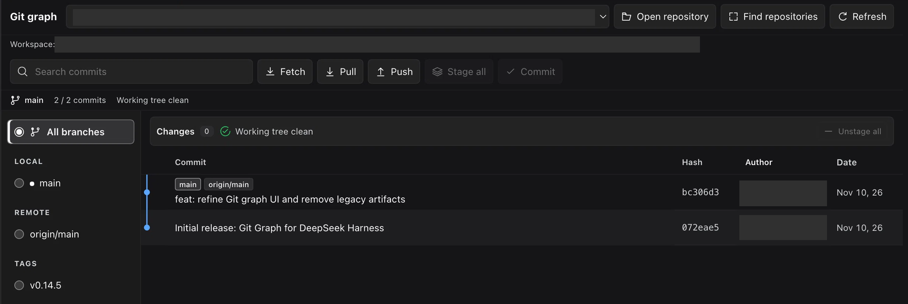

# Git Graph for DeepSeek Harness

Commit history, file diffs and working-tree changes—inside your Harness conversation.

**Harness:** `0.2.2-rc.1` / `0.2.2-rc.2` · **Profiles:** Web / Desktop · **UI:** Harness language · **License:** [MIT](./LICENSE)

**Category:** Development & Operations

[Português](./README_PTBR.md) · [Changelog](./CHANGELOG.md) · [Report an issue](https://github.com/EdgarSantiago/dsh-git-graph/issues)

## Preview



*Actual plugin UI. Local paths and author names are redacted for privacy; unused space was cropped.*

## Install from GitHub

Requires **DeepSeek Harness `0.2.2-rc.1` or `0.2.2-rc.2`**, **Node.js 18+**, and **Git on PATH**. Other Harness versions are not declared compatible.

**Web profile**

```sh
dsh plugin --profile web add github:EdgarSantiago/dsh-git-graph
```

**Desktop profile**

```sh
dsh plugin --profile desktop add github:EdgarSantiago/dsh-git-graph
```

Open a conversation and select **Git graph**. Follow any reload guidance returned by the plugin manager.

This is **GitHub-only distribution**, not an npm release. The package identifier is `@edgarsantiago/dsh-git-graph`; its `private: true` flag prevents accidental npm publication, not installation from GitHub.

## What you can do

| Area | Features |
| --- | --- |
| History | Commit graph, search, local/remote branch and tag filters, paginated history |
| Inspection | Commit details, changed files, per-file diffs, file history and commit comparison |
| Working tree | Compact Changes summary, staged/unstaged/untracked groups, batch selection |
| Git operations | Stage, unstage, restore, ignore, commit, fetch, pull, push, branches and tags |
| Workspace | Automatic repository discovery and remembered selection isolated per workspace |
| Interface | Native Harness tab and theme, aligned headers, visible selections, icon-labeled actions |

There is no iframe or separate React installation. Controls, accessibility labels, confirmations, notices and dates follow **Settings → Language** reactively: English (`en`), Brazilian Portuguese (`pt`, alias `pt-BR`), Chinese (`zh`), Japanese (`ja`), Spanish (`es`), French (`fr`), German (`de`) and Russian (`ru`). There is no plugin language selector or saved override; changing the language preserves the open view and confirmation state. Commit messages, authors, branches, paths and raw Git output remain unchanged. Missing translations use the Harness locale service’s fallback chain (English, then the key).

## Everyday use

1. **Choose a repository.** Repositories in the current workspace appear automatically. Use **Find repositories** to rescan or **Open repository** to add a folder explicitly.
2. **Inspect history.** Filter by a branch/tag or search by message, author or hash. Click a commit to open its details.
3. **Compare commits.** Choose **Compare** in one commit's details, then select another commit.
4. **Review changes.** Expand **Changes**, inspect file diffs and select files individually or in a batch.
5. **Confirm writes.** Review the repository, operation and files in the confirmation dialog before executing.

Use **Refresh** after changes made outside the panel. Refresh also rescans the repository list.

### Action availability

- **Stage all:** enabled when unstaged or untracked files exist.
- **Unstage all:** enabled when staged files exist.
- **Commit:** enabled when local changes exist. Stage files first or use the dialog's **Stage all files before committing** option.
- **Fetch / Pull / Push:** remain available with a clean worktree; they do not depend on local file changes.

Actions are disabled while loading or running an operation. Narrow panes retain a branch picker and the selected branch/tag's available actions.

### Keyboard shortcuts

| Shortcut | Action |
| --- | --- |
| `↑` / `↓` | Select a commit |
| `Enter` | Open commit details |
| `Ctrl/⌘ + F` | Focus commit search |
| `Escape` | Close details or the active confirmation |

## Workspace isolation

Discovery checks the workspace root and up to **two directory levels** below it, including sibling repositories, nested repositories and Git worktrees. Each scan is limited to **300 directories and 20 repositories**; hidden/heavy directories and external symlinks are skipped.

Explicitly opened folders and the selected repository are remembered only for their workspace. Switching workspaces cancels old requests and clears details and confirmations. An empty workspace stays empty: the plugin does not substitute a globally remembered repository, ascend into another project's Git root, or initialize Git automatically.

## Permissions and safety

> **Restore/discard can lose local changes. Push publishes commits.** Always review the confirmation dialog.

- **Local access:** reads repository history, refs, configuration, status and requested file diffs; confirmed operations can modify files, the index and Git refs.
- **Write protection:** UI writes require confirmation. The `git_graph_operation` Agent tool requires approval for each call and is restricted to the Agent's current repository. Both use the same executor.
- **Request protection:** Harness authentication, same-origin POST checks for writes, canonical repository/workspace authorization, path and symlink validation, bounded diagnostics and credential redaction.
- **Execution:** Git runs through `execFile` with argument arrays, not shell interpolation. Failed status/index reads return an error instead of a false clean state.
- **Network:** fetch, pull and push use your configured Git remotes and credential setup. **Open remote commit** opens an HTTPS hosting link in your browser.
- **Persistence:** browser storage remembers repository choices per canonical workspace path. The UI and commit-message suggestion heuristic do not call an AI service; normal Agent conversations retain their usual model usage.

The plugin adds no telemetry endpoint or automatic self-update.

## Compatibility and limits

- Live plugin registration and development were checked on **macOS**. Other operating systems' GUIs have not been certified.
- History loads **200 commits per page**, with one branch filter at a time and up to **eight visual graph lanes**.
- There is no automatic polling; use **Refresh** for external changes.
- The historical `/git-graph-bilingual/api` endpoint and Slot ID remain stable for compatibility, independently of locale support. No separate language selector is added.

### Community catalog

The repository carries the **`dsh-plugin`** topic and follows the [community catalog requirements](https://dsh-plugin.org/submit). The website can index public GitHub source repositories after its scan/review; the Plugin Hub inside DSH additionally requires an npm package. No listing or community verification is claimed here.

## Development

```sh
pnpm install --frozen-lockfile --ignore-scripts
pnpm run check
pnpm test
```

No build step or production dependencies are required. The single ModuleLoader client embeds all dictionaries and uses the native Harness locale service (`ctx.locale`) with effect-owned registrations and a reactive snapshot subscription. Metadata in `locale/*.json` covers every language and the Portuguese alias. Tests use Node's built-in runner, the Cordis SDK and isolated real Git repositories kept inside this folder. Coverage includes auth/origin checks, path boundaries, workspace races, lifecycle disposal, confirmed operations, failed index reads, UI action states, dictionary key parity, aliases, date/fallback formatting, language-selection wiring and live notice/confirmation formatting. Automated checks do not replace visual review in Harness.

- [Host entry](./index.js): Git API and approval-gated Agent tool.
- [Client entry](./client.js): native conversation view.
- [Bundle patch](./cordis.patch.yml): plugin registration.

## License and credits

Maintained by [EdgarSantiago](https://github.com/EdgarSantiago). This independent, AI-assisted adaptation is based on [1841220388zzzcccxxx-star/dsh-git-graph](https://github.com/1841220388zzzcccxxx-star/dsh-git-graph), with its original copyright notice retained under the [MIT license](./LICENSE). It is not an official DeepSeek product.
