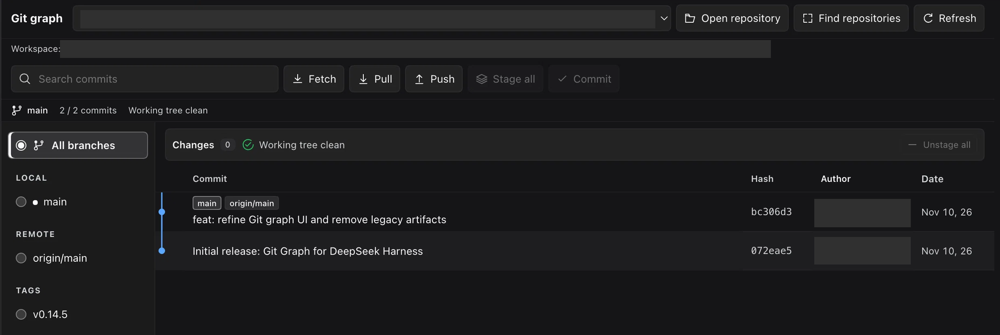

# Git Graph para DeepSeek Harness

Histórico de commits, diferenças por arquivo e alterações locais dentro da conversa do Harness.

**Harness:** `>=0.2.2-rc.1 <0.2.3-0` · **Perfis:** Web / Desktop · **Interface:** idioma do Harness · **Licença:** [MIT](./LICENSE)

[English](./README.md) · [Histórico de versões](./CHANGELOG.md) · [Reportar problema](https://github.com/EdgarSantiago/dsh-git-graph/issues)

## Prévia



*Interface real do plugin. Caminhos locais e nomes de autores foram ocultados para preservar a privacidade; o espaço vazio foi recortado.*

## Instalação pelo GitHub

Requer **DeepSeek Harness `>=0.2.2-rc.1 <0.2.3-0`**, **Node.js 18+** e **Git no PATH**. Esta política autorizada pelo usuário admite a linha 0.2.2 desde rc.1, inclusive a versão estável, mas bloqueia até os pré-lançamentos de 0.2.3. Mantém as evidências de regressão de rc.1/rc.2 e inclui inspeção dos contratos Host/Client relevantes da rc.3 instalada. Futuras candidatas de 0.2.2 são admitidas pela política, não certificadas individualmente; a verificação visual continua separada.

**Perfil Web**

```sh
dsh plugin --profile web add github:EdgarSantiago/dsh-git-graph
```

**Perfil Desktop**

```sh
dsh plugin --profile desktop add github:EdgarSantiago/dsh-git-graph
```

Abra uma conversa e selecione **Grafo Git** (ou o nome no idioma atual). Siga a orientação de recarga retornada pelo gerenciador de plugins, se houver.

O pacote é `@edgarsantiago/dsh-git-graph`, distribuído somente pelo GitHub nesta versão, sem publicação no npm. A flag `private: true` impede publicação acidental no npm; ela não impede a instalação pelo GitHub.

## Recursos

| Área | O que oferece |
| --- | --- |
| Histórico | Grafo, busca, filtro por branch local/remota ou tag e paginação |
| Inspeção | Detalhes de commits, arquivos alterados, diffs, histórico de arquivo e comparação |
| Alterações | Resumo compacto, grupos de preparados/não preparados/não rastreados e seleção em lote |
| Operações | Stage, unstage, restore, ignore, commit, fetch, pull, push, branches e tags |
| Workspace | Descoberta automática e seleção de repositório isoladas por workspace |
| Interface | Aba nativa, tema do Harness, cabeçalhos alinhados, seleção visível e botões com ícones |

Não há iframe nem instalação separada do React. Controles, rótulos de acessibilidade, confirmações, avisos e datas seguem **Settings → Language** reativamente: inglês (`en`), português brasileiro (`pt`, alias `pt-BR`), chinês (`zh`), japonês (`ja`), espanhol (`es`), francês (`fr`), alemão (`de`) e russo (`ru`). Não há seletor próprio nem preferência de idioma salva pelo plugin; a troca preserva a visão aberta e o estado da confirmação. Mensagens de commits, autores, branches, caminhos e saída bruta do Git não são traduzidos. Traduções ausentes seguem o fallback nativo do Harness (inglês e, por último, a chave).

## Uso diário

1. **Escolha o repositório.** As pastas Git do workspace aparecem automaticamente. Use **Buscar repositórios** para refazer a busca ou **Abrir repositório** para adicionar uma pasta explicitamente.
2. **Explore o histórico.** Filtre por branch/tag, pesquise e clique em um commit para abrir seus detalhes.
3. **Compare commits.** Selecione **Comparar** nos detalhes de um commit e depois escolha outro.
4. **Revise as alterações.** Expanda **Alterações**, confira os diffs e selecione arquivos individualmente ou em lote.
5. **Confirme as escritas.** Confira o repositório, a operação e os arquivos no diálogo antes de executar.

Use **Atualizar** após alterações externas. Esse botão também atualiza a lista de repositórios.

### Estados dos botões

- **Preparar tudo:** disponível com arquivos não preparados ou não rastreados.
- **Despreparar tudo:** disponível quando há arquivos preparados.
- **Criar commit:** disponível com alterações locais. Prepare os arquivos antes ou marque **Preparar todos os arquivos antes do commit** no diálogo.
- **Buscar remotos / Puxar alterações / Enviar alterações:** continuam disponíveis com a árvore limpa; não dependem de alterações locais.

As ações ficam desabilitadas durante carregamento/operações. Em painéis estreitos, o seletor de branches preserva as ações disponíveis para a branch/tag escolhida.

### Atalhos

| Atalho | Ação |
| --- | --- |
| `↑` / `↓` | Selecionar commit |
| `Enter` | Abrir detalhes |
| `Ctrl/⌘ + F` | Focar a busca |
| `Escape` | Fechar detalhes ou a confirmação ativa |

## Isolamento por workspace

A busca verifica a raiz e até **dois níveis de subpastas**, incluindo repositórios irmãos, internos e worktrees. Cada varredura examina até **300 diretórios e 20 repositórios**, ignorando pastas pesadas/ocultas e symlinks externos.

Pastas abertas manualmente e a seleção pertencem somente ao workspace atual. A troca cancela requisições antigas e limpa detalhes e confirmações. Um workspace sem Git permanece vazio: o plugin não escolhe outro projeto como fallback, não sobe para uma raiz Git externa e não inicializa repositórios automaticamente.

## Permissões e segurança

> **Restore/discard pode apagar alterações locais. Push publica commits.** Revise sempre a confirmação.

- Lê histórico, refs, configuração, status e diffs solicitados. Operações confirmadas podem modificar arquivos, o índice e refs do Git.
- Escritas pela UI exigem confirmação. A ferramenta `git_graph_operation` exige aprovação em cada chamada e fica limitada ao repositório atual do Agent; ambos usam o mesmo executor.
- Exige autenticação do Harness, POST de mesma origem para escritas e autorização de workspace/repositório, com validação de caminhos e symlinks e diagnósticos limitados, com dados sensíveis ocultados.
- Executa Git com `execFile` e argumentos separados, sem interpolação de shell. Falhas ao ler o índice/status retornam erro explícito em vez de um falso estado limpo.
- Fetch, pull e push usam os remotes e as credenciais já configurados no Git. **Abrir commit remoto** abre um link HTTPS no navegador.
- O armazenamento do navegador guarda as escolhas por workspace. A UI e a sugestão heurística de mensagem não chamam IA; conversas normais do Agent mantêm seu consumo habitual.

O plugin não adiciona endpoint de telemetria nem autoatualização.

## Compatibilidade e limites

- Desenvolvimento e registro ao vivo verificados no **macOS**; não há certificação visual das outras plataformas.
- Histórico em páginas de **200 commits**, um filtro de branch por vez e até **oito trilhas visuais**.
- Sem polling automático: use **Atualizar** após alterações externas.
- O endpoint `/git-graph-bilingual/api` e o ID do Slot são mantidos por compatibilidade, independentemente do suporte a idiomas. Não há seletor de idioma próprio.

### Catálogo comunitário

O repositório usa o tópico **`dsh-plugin`** e segue os [requisitos do catálogo](https://dsh-plugin.org/submit). O site pode indexar repositórios públicos após a varredura/revisão; o Plugin Hub dentro do DSH exige também um pacote npm. Não há afirmação de listagem ou verificação comunitária concluída.

## Desenvolvimento

```sh
pnpm install --frozen-lockfile --ignore-scripts
pnpm run check
pnpm test
```

Não há build nem dependências de produção. O Client ModuleLoader único inclui todos os dicionários e usa o serviço nativo `ctx.locale`, com registros vinculados ao ciclo de vida e assinatura reativa do snapshot. Os metadados `locale/*.json` cobrem todos os idiomas e o alias português. Os testes usam o runner nativo do Node, o SDK do Cordis e repositórios Git reais e isolados dentro desta pasta. Cobrem autenticação/origem, caminhos, isolamento, ciclo de vida, operações confirmadas, falhas no índice, estados de ações, paridade de chaves, aliases, datas/fallbacks, integração da seleção de idioma e formatação reativa de avisos/confirmações. A validação automatizada não substitui a revisão visual no Harness.

- [Host](./index.js): API Git e ferramenta com aprovação.
- [Client](./client.js): visão nativa da conversa.
- [Bundle](./cordis.patch.yml): registro do plugin.

## Licença e créditos

Mantido por [EdgarSantiago](https://github.com/EdgarSantiago). Adaptação independente, desenvolvida com auxílio de IA, baseada no [dsh-git-graph original](https://github.com/1841220388zzzcccxxx-star/dsh-git-graph), com o aviso de copyright preservado sob a [licença MIT](./LICENSE). Não é um produto oficial da DeepSeek.
